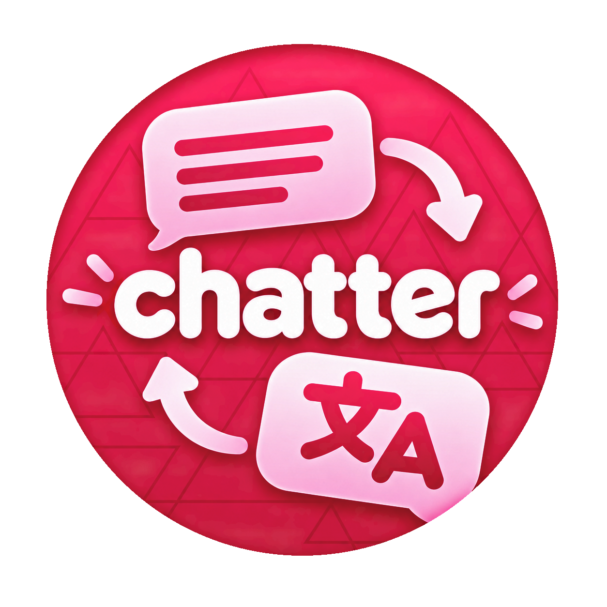

# osu-chatter

<p align="center">
  
</p>

**A separate chat window for osu!stable.** Read chats you already have open in the game, translate messages, and reply without switching back to the game window.

This is an unofficial community project. It is not affiliated with osu! or its developers.

## What it does

- Shows open channel and private-message tabs. Join new channels in osu!stable.
- Keeps your reading position as messages arrive.
- Translates incoming and outgoing messages using a local translator, DeepL, or a LibreTranslate server.
- Sends only when you press **Send** or **Enter**. Messages are not retried automatically.

## Download

Windows builds are published on the [Releases page](https://github.com/osu-chatter/osu-chatter/releases). Extract the full ZIP and run `chatter.exe`. Keep `chatter.exe.config` beside it.

Chatter runs on 64-bit Windows 10 or 11 with .NET Framework 4.8. You don't need Visual Studio, the .NET SDK, or a separate Python install to run a release.

## Build and run

To build from source, install the .NET 10 SDK and .NET Framework 4.8. If the build reports `MSB3644`, install the .NET Framework 4.8 Developer Pack too. From the repository folder, run `run.bat` to build and launch chatter.

The other launchers are `build.bat` to build, `check.bat` to run the offline checks, and `package.bat` to create a release ZIP in `dist/`. Add `-NoPause` when running one from PowerShell or automation. For example:

```powershell
.\check.bat -NoPause
.\package.bat -NoPause -Version v1.0.0
```

Game offsets, signatures, and reflected member names are maintained together in [`src/Shared/StableCompatibilityProfile.cs`](src/Shared/StableCompatibilityProfile.cs). See the [compatibility guide](docs/stable-compatibility.md) for more instructions.

## Translation

On first launch, choose a provider and languages. You can change them later in **Settings → Translation preferences**.

- **Local:** Chatter downloads its private translation runtime during setup and language models as needed. Downloads require internet access and models can be large. Cached language pairs work offline. The translator runs locally and does not open a network port.
- **DeepL API:** Enter an API key for the Free or Pro plan. Text sent for translation goes to DeepL and counts toward your API usage. A regular DeepL website subscription does not include an API key.
- **LibreTranslate:** Enter your server's `/translate` URL and optional API key. Text goes to that server; remote servers must use HTTPS.

Local translation supports English, Polish, Russian, Korean, Japanese, Chinese, German, French, Spanish, Portuguese, and Ukrainian. Other language pairs translate through English. Results can vary, especially for short messages.

## Chat and privacy

Chatter reads conversations that are already open in osu!stable. It does not log in to osu!, call the osu! API, join channels, or save chat text to disk. Selecting a conversation in chatter does not change the game's selected tab.

Sending is always a separate action. Chatter checks the selected account and target before sending; it won't submit commands, blank messages, or messages longer than 400 characters. Use the same Windows privilege level for chatter and osu!stable. Usually neither needs administrator access.

Translation providers receive text as described above. Settings are kept under `%LOCALAPPDATA%/osu-chatter/settings.json`; API keys are protected for your Windows account with DPAPI.

## Troubleshooting

- If chatter cannot read the game, open osu!stable and leave the conversations you want to read open. If the game runs as administrator, run chatter the same way.
- The first local translation setup needs internet access. It downloads a Python runtime and dependencies; language models download when first used and may take several minutes.
- DeepL errors can indicate an invalid key, exhausted usage, or a plan mismatch. Check the API plan and key in translation preferences.

## License

osu-chatter is provided under the [PolyForm Noncommercial License 1.0.0](LICENSE). It permits noncommercial use, modification, and redistribution. Commercial use is not permitted under this license.
